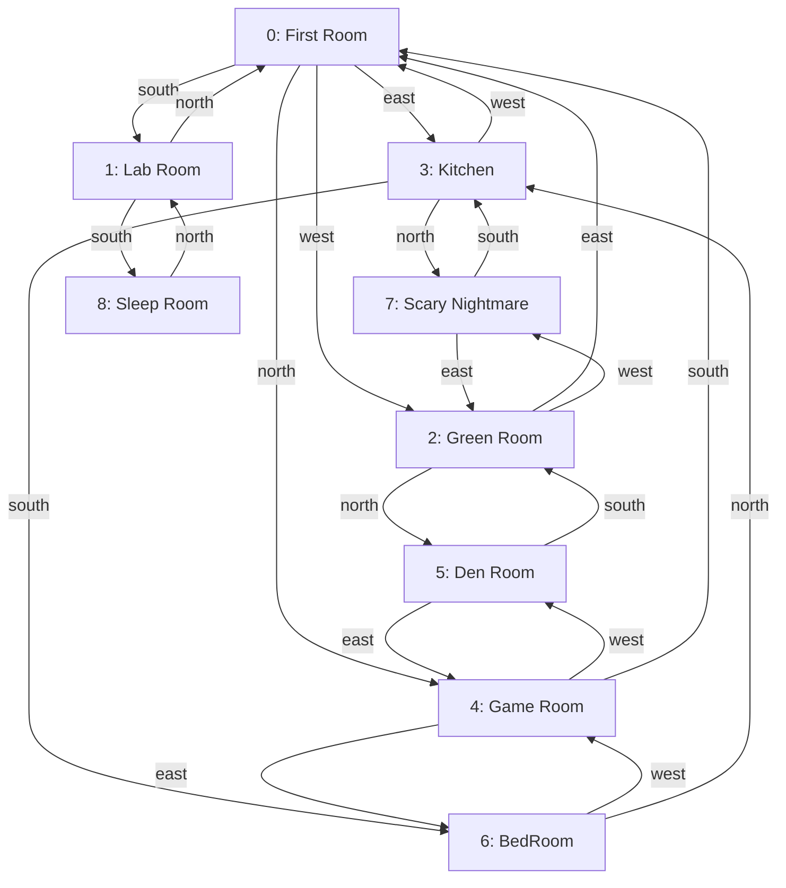

# Text-Based-RPG
A short text-based RPG. Explore a mysterious house room by room, collect items, interact with your environment, and navigate through a branching world—all through your command line.

Author: Timothy Johnson  
Date: January 2021 to February 2021

## Overview

&nbsp;&nbsp;&nbsp;&nbsp;This is a text-based role-playing game (RPG) built in Java that allows players to explore a series of interconnected rooms in a house.
Each room contains items that can be picked up or dropped, and rooms may have unique mechanics (such as healing).
Players can navigate using typed commands and manage an inventory system.

🧩 Features

    🧍 Player creation and inventory system

    🧭 Room navigation with cardinal directions (north, south, east, west)

    🪑 Dynamic room objects and interactions

    🛏️ Special rooms (e.g., Sleep Room that heals the player)

    🛠️ Command-based interaction system (like look, inventory, pick up, and use)

    ❤️ Health system with consumable food and potions

    ⚔️ Turn-based monster battles with accuracy, status effects, and healing items

    📦 Utility class for modular string-based item management

🎮 Gameplay

You begin by entering a room and are prompted with command options. Each action affects the game's state.

### Available Commands:

| Command     | Description                                    |
| ----------- | ---------------------------------------------- |
| `look`      | List all visible items in the room             |
| `inventory` | Check what items you're currently carrying     |
| `go <dir>`  | Move to a new room (where `<dir>` is n/e/s/w)  |
| `pick up`   | Pick up an item from the room                  |
| `drop`      | Drop an item from your inventory into the room |
| `use`       | Choose a health potion or food item to consume |
| `use <item>`| Consume a named health item directly |
| `exits`     | Show all available exits from the current room |
| `help`      | Show help menu with commands                   |
| `quit`      | Exit the game                                  |

When entering a monster room, choose an attack by its displayed number or name.
You can also use a healing item with `use <item>` during your turn. Successful
attacks respect their accuracy and may apply poison, stun, or weaken effects.

### Game Map (GameVersion4)

Each arrow shows a direction you can travel from one room. Some exits are
one-way.

📁 Code Structure

.  
├── CustomPlayer.java &nbsp;&nbsp;&nbsp;---&nbsp;&nbsp;&nbsp; Defines the custom player, health, inventory, and interactions  
├── HealthItem.java &nbsp;&nbsp;&nbsp;---&nbsp;&nbsp;&nbsp; Immutable definition of a healing item  
├── HealthItemCatalog.java &nbsp;&nbsp;&nbsp;---&nbsp;&nbsp;&nbsp; Registry of foods and potions that restore health  
├── GameDemoSimple.java &nbsp;&nbsp;&nbsp;---&nbsp;&nbsp;&nbsp; Demo entry point of the game and room setup  
├── GameVersion2.java &nbsp;&nbsp;&nbsp;---&nbsp;&nbsp;&nbsp; Second entry point of the game and room setup  
├── GameVersion3.java &nbsp;&nbsp;&nbsp;---&nbsp;&nbsp;&nbsp; Third entry point of the game and room setup  
├── GameVersion4.java &nbsp;&nbsp;&nbsp;---&nbsp;&nbsp;&nbsp; Fourth entry point of the game and room setup  
├── GameInput.java &nbsp;&nbsp;&nbsp;---&nbsp;&nbsp;&nbsp; Shared console input scanner  
├── Attack.java &nbsp;&nbsp;&nbsp;---&nbsp;&nbsp;&nbsp; Immutable attack definition shared by player and monster  
├── AttackEffect.java &nbsp;&nbsp;&nbsp;---&nbsp;&nbsp;&nbsp; Supported special attack effects  
├── PlayerAttackSet.java &nbsp;&nbsp;&nbsp;---&nbsp;&nbsp;&nbsp; Player's available attacks  
├── MonsterRoom.java &nbsp;&nbsp;&nbsp;---&nbsp;&nbsp;&nbsp; Monster Room logic  
├── Player.java &nbsp;&nbsp;&nbsp;---&nbsp;&nbsp;&nbsp; Defines the player, inventory, and interactions  
├── README.md  
├── Room.java &nbsp;&nbsp;&nbsp;---&nbsp;&nbsp;&nbsp; Generic room logic, including navigation and item handling  
├── SleepRoom.java &nbsp;&nbsp;&nbsp;---&nbsp;&nbsp;&nbsp; Sleep room logic to allow player to heal  
├── SubClass.java  
├── SuperClass.java  
├── Trying.java  
├── Utilities.java &nbsp;&nbsp;&nbsp;---&nbsp;&nbsp;&nbsp; Helper methods for string manipulation and command reference  

⚙️ How It Works  
Player Initialization: The game creates a player with a name, starting room, and an empty or pre-defined inventory.

Room Interaction: Each room contains:

    A unique name

    Items to interact with

    List of directional exits

🖼️ Screenshots / Visuals

🧰 Technologies Used

    Java 17 (or specify version)

    Command Line Interface (CLI)

    OOP Principles (Encapsulation, Inheritance via CustomPlayer, etc.)

    Tokenizer and StringBuilder for parsing and managing state

🚀 Getting Started

    To run this project on your local machine:

    1. Clone this repository

        git clone https://github.com/MrTimmyJ/text-based-rpg-java.git
        cd text-based-rpg-java

    2. Compile all Java files

       javac *.java

    3. Run the game

       java GameVersion4

📝 Note: `GameVersion4` is the recommended entry point for the current health and inventory features. It uses `CustomPlayer`, starts the player at 50/100 HP, and places a Health Potion in the Kitchen. `GameVersion3` also supports health items. `GameDemoSimple` and `GameVersion2` are earlier examples that still use the basic `Player` class.

🌱 Planned Features

    🎲 Random events or item spawns

    🗺️ Map system to visualize progress

    💾 Save/Load system using file I/O

    🧙 NPC interactions with dialogue options

    📜 Quest system with objectives

🪪 License

This open-source project is available under the [MIT License](https://opensource.org/license/mit).
