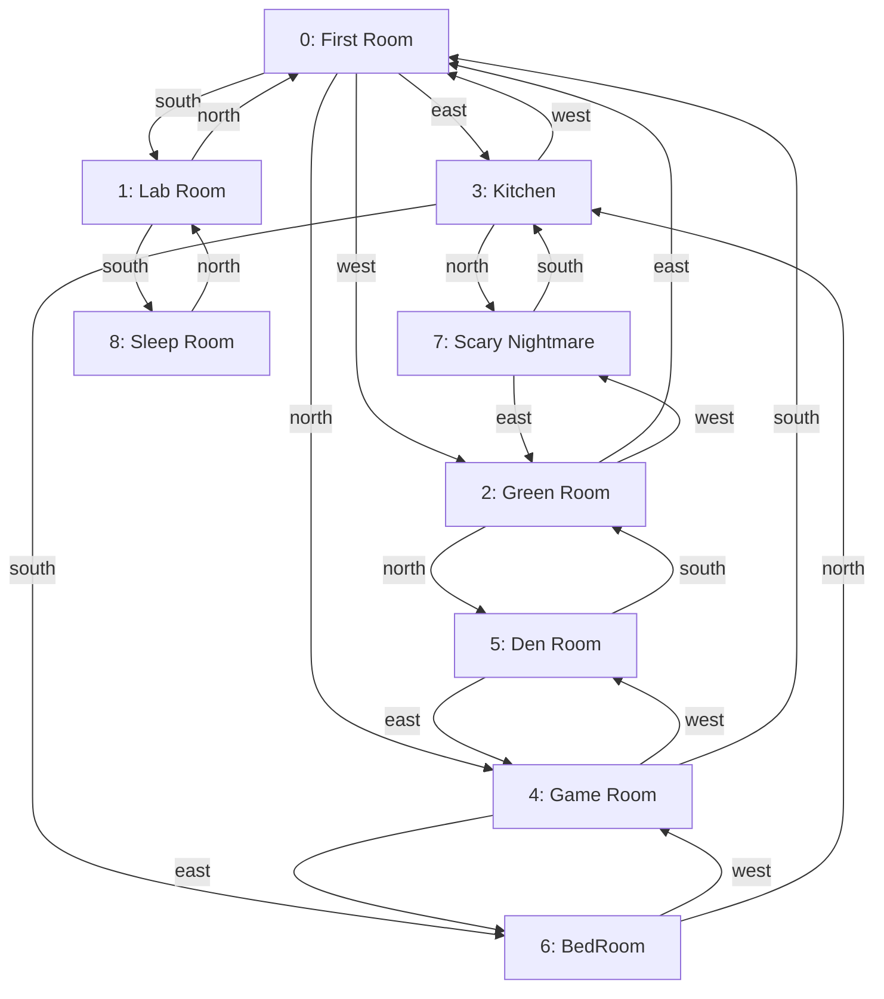

# Text-Based-RPG
A short text-based RPG. Explore a mysterious house room by room, collect items, interact with your environment, and navigate through a branching world—all through your command line.

## Overview

&nbsp;&nbsp;&nbsp;&nbsp;This is a text-based role-playing game (RPG) built in Java that allows players to explore a series of interconnected rooms in a house.
Each room contains items that can be picked up or dropped, and rooms may have unique mechanics (such as healing).
Players can navigate using typed commands and manage an inventory system.

🧩 Features

    🧍 Player creation and inventory system

    🧭 Room navigation with cardinal directions (north, south, east, west)

    🪑 Dynamic room objects and interactions

    🛏️ Special rooms (e.g., Sleep Room that heals the player)

    🛠️ Command-based interaction system (like look, inventory, pick up, and use)

    ❤️ Health system with consumable food and potions

    ⚔️ Turn-based monster battles with accuracy, status effects, and healing items

    📦 Utility class for modular string-based item management

🎮 Gameplay

You begin by entering a room and are prompted with command options. Each action affects the game's state.

### Available Commands:

| Command     | Description                                    |
| ----------- | ---------------------------------------------- |
| `look`      | List all visible items in the room             |
| `inventory` | Check what items you're currently carrying     |
| `go <dir>`  | Move to a new room (where `<dir>` is n/e/s/w)  |
| `pick up`   | Pick up an item from the room                  |
| `drop`      | Drop an item from your inventory into the room |
| `use`       | Choose a health potion or food item to consume |
| `use <item>`| Consume a named health item directly |
| `exits`     | Show all available exits from the current room |
| `help`      | Show help menu with commands                   |
| `quit`      | Exit the game                                  |

When entering a monster room, choose an attack by its displayed number or name.
You can also use a healing item with `use <item>` during your turn. Successful
attacks respect their accuracy and may apply poison, stun, or weaken effects. The
monster now also varies its own attacks, using different styles such as claw
swipes, venom bites, stun slams, and weakening roars.

### Game Map

Each arrow shows a direction you can travel from one room. Some exits are
one-way.

📁 Code Structure

- `GameVersionFinal.java` — main entry point and room setup
- `Room.java` — abstract base class for all rooms
- `StandardRoom.java` — ordinary exploration room
- `MonsterRoom.java` — monster battle room
- `SleepRoom.java` — room with the sleep healing action
- `Player.java` and `CustomPlayer.java` — player, inventory, health, and attack set
- `Attack.java`, `AttackEffect.java`, `PlayerAttackSet.java` — player attack definitions
- `Consumable.java`, `HealthItem.java`, `HealthItemCatalog.java` — health item contract and registry
- `GameInput.java` — shared console input
- `Utilities.java` — inventory and command helpers

⚙️ How It Works  
Player Initialization: The game creates a player with a name, starting room, and an empty or pre-defined inventory.

Room Interaction: Each room contains:

    A unique name

    Items to interact with

    List of directional exits

## Object-Oriented Design

### Abstract class: `Room`

`Room` is an abstract base class. It contains shared room data and reusable behavior such as navigation, displaying objects, picking up and dropping items, and the common room command loop. It declares `playRoom(CustomPlayer)` as abstract, because every concrete room must decide what happens when the player enters it.

- `StandardRoom` implements the normal exploration behavior by calling the shared room command loop.
- `MonsterRoom` implements the monster encounter and then returns to normal room interaction.
- `SleepRoom` implements the sleep action as well as the normal room commands.

`GameVersionFinal` stores these different room objects in a `Room[]`. Calling `playRoom(player)` therefore uses polymorphism to run the behavior of the actual room object.

### Interface: `Consumable`

`Consumable` defines the common contract for an inventory item that can be consumed by a `CustomPlayer`. `HealthItem` implements this interface and applies its healing effect through `consume(player)`. `CustomPlayer` uses the interface instead of depending directly on the implementation when applying an item's effect. This allows another consumable type to implement the same contract later.

🧰 Technologies Used

    Java 17 (or specify version)

    Command Line Interface (CLI)

    OOP Principles (Encapsulation, Inheritance via CustomPlayer, etc.)

    Tokenizer and StringBuilder for parsing and managing state

🌱 Planned Features

    🎲 Random events or item spawns

    🗺️ Map system to visualize progress

    💾 Save/Load system using file I/O

    🧙 NPC interactions with dialogue options

    📜 Quest system with objectives
